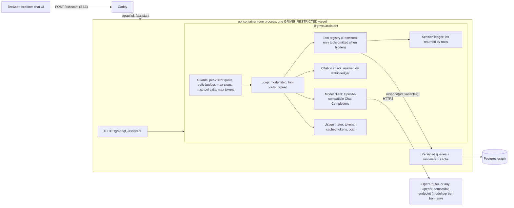

# Assistant agent architecture: hand-rolled loop, SDK or framework, and where it runs

Research for [Which agent architecture fits the explorer: hand-rolled loop, SDK or framework, and where does it run?](https://github.com/george-vrancianu/grivei.ai/issues/336), part of the map [#332](https://github.com/george-vrancianu/grivei.ai/issues/332). It is bound by [ADR 0017](../adr/0017-the-assistant-answers-from-the-graph-through-tools.md) (tools over the graph, citations checked in code, visibility enforced in the tool layer), [ADR 0015](../adr/0015-go-live-needs-only-a-privacy-notice-restricted-data-sits-behind-a-toggle.md) (`GRIVEI_RESTRICTED`) and [ADR 0005](../adr/0005-search-is-per-source.md) (search is per Source).
Researched 2026-11-25. Versions and dates come from the npm and PyPI registries; everything else comes from each project's own docs or repo, linked inline.

**Question.** How should the Assistant's tool loop be built: hand-rolled over a thin provider-neutral client, the Vercel AI SDK, the OpenAI Agents SDK, Mastra, LangGraph.js, PydanticAI in `watchdog/`, or tools exposed over MCP? Should it run inside the `api` process or as a separate Compose service? And how do its tools reuse the persisted queries and honour `GRIVEI_RESTRICTED`?

## Answer in brief

- **Recommendation: a hand-rolled tool loop, in TypeScript, inside the `api` process, over a provider-neutral OpenAI-compatible Chat Completions client.** OpenRouter is the default endpoint; any OpenAI-compatible base URL works.
  - The loop is small: call the model, run the requested tools, append the results, repeat until it answers or hits a limit. Everything ADR 0017 and the map need sits *around* that loop, and none of the frameworks provides it: the per-session ledger of returned ids, the citation check, the per-session and daily cost budget, the step and tool-call caps, and the Restricted-aware tool layer.
  - The client can be the `openai` npm package, which has **zero runtime dependencies** (7.64.0, 2026-11-24, Apache-2.0), or plain `fetch`. The `api` package today depends only on `graphql` and `pg` (`explorer/packages/api/package.json`).
- **The tools call the existing persisted-query path in-process.** They go through `Api.respond({ id, variables })` (`explorer/packages/api/src/server.ts`), not the resolvers directly and not over HTTP. Each tool is a persisted operation, so:
  - the allowlist stays the only way into the graph;
  - the Restricted switch the API already reads once applies to the Assistant unchanged;
  - the result cache (`cache.ts`) is shared.
  
  The tools need a few new, slim operations in the contract (`operations/assistant.graphql`), because the UI's operations are shaped for screens and cost many tokens. ADR 0017's "path between two entities" doesn't exist yet as a query at all.
- **The tier follows the process.** A host runs the API with `GRIVEI_RESTRICTED=show` (a Private view) or without it (the public tier). The Assistant in that process inherits the switch and picks its model from the env, for example `ASSISTANT_MODEL`. One seam, a model per tier, nothing to keep in sync.
- **Runner-up: the Vercel AI SDK v7 core** (`ai`, `generateText`/`streamText` with `stopWhen`, `onStepEnd`, `prepareStep`). It is the best of the frameworks: provider-neutral, gives full access to each step's tool results, and has cache-token usage fields. It loses on churn and weight for this project:
  - three majors in under a year (v5 2025-07, v6 2025-12, v7 2026-06), with renamed APIs in v7;
  - 56 releases in the 30 days before this research;
  - it always pulls in Vercel's `@ai-sdk/gateway`;
  - it still leaves the ledger, the citation check and the budgets to us.
  
  Switch to it if we later need several native provider APIs (not just OpenAI-compatible ones) or its UI stream protocol.
- **Not recommended:**
  - **OpenAI Agents SDK:** OpenAI-first, pre-1.0, and tracing exported to OpenAI by default.
  - **Mastra:** heavy, and some parts are under an enterprise licence.
  - **LangGraph.js:** brings in `@langchain/core` and `langsmith`; a graph runtime for a single loop.
  - **PydanticAI:** has the best built-in limits (including `cost_limit`), but it is Python. `watchdog/` is a batch pipeline, not a server, so it would mean a new Python service calling the API over HTTP.
  - **MCP:** a way to expose tools, not a loop. It is worth adding later as a thin adapter over the same tool registry, for example so a journalist's own MCP client can use the tools in a Private view. It is not the architecture.

## 1. What the loop must do (from ADR 0017 and the map #332)

| Need | Source | What it implies for the loop |
|---|---|---|
| A model per tier behind one seam; the cheapest that passes the eval, measured as cost per question | #332 | Provider-neutral client; model id from config; per-question token and cost accounting, cached tokens included |
| OpenAI-compatible endpoints, OpenRouter | ticket | Chat Completions shape as the lowest common denominator |
| Hard global daily budget that turns the Assistant off; small per-visitor quota | #332 public guards | A counter checked *before* each model call, not only after a run |
| Every claimed id must have come back from a tool call in the same session | ADR 0017 | Every tool result must be visible to our code, and the ids are extracted into a session ledger |
| Visibility in the tool layer under `GRIVEI_RESTRICTED` | ADR 0017, ADR 0015 | Tools must read through the same switch as the API |
| No link the graph didn't return; per-Source rules (no summing across Sources, CUI identity) | ADR 0017, 0014, 0003, 0013 | Tools return graph facts, never computed cross-Source totals |
| Streaming to the browser | ticket | An SSE endpoint |
| Structured answer the citation check can read | #332 "answer format" | Structured output or an "answer" tool |
| Prompt caching | ticket | A stable prefix (instructions + tool definitions) and passthrough of the provider's cache hints |

## 2. The options against the criteria

| Criterion | Hand-rolled (`openai` pkg or `fetch`) | AI SDK v7 | OpenAI Agents JS | Mastra | LangGraph.js | PydanticAI | MCP server |
|---|---|---|---|---|---|---|---|
| Provider neutrality | Any OpenAI-compatible URL, including OpenRouter | High: openai-compatible, OpenRouter, Anthropic providers | Medium: Chat Completions path or a **beta** AI SDK adapter | High: model router plus AI SDK models | High: provider packages | High, including OpenRouter | n/a: the client brings the model |
| Streaming | Our own SSE (small) | SSE UI message stream protocol, `useChat` | Event stream | `agent.stream` | Six stream modes | `run_stream_events` | n/a |
| Step / tool-call limits | Our own counters | `stopWhen` (default `isStepCount(1)`), `activeTools` | `maxTurns` (default 10) | `maxSteps` (default 5) | `recursionLimit` (default 25) | `UsageLimits`: requests, tool calls, tokens, **cost** | n/a |
| Cost accounting | OpenRouter returns `usage.cost` and cached tokens on every response | Tokens with cache read/write; no cost field | Tokens | Tokens | Tokens + `cache_read` | Tokens + USD estimate via `genai-prices` | n/a |
| Tool results for the citation check | Direct | `steps`, `onStepEnd`, `onToolExecutionEnd` | `newItems` | `toolResults`, `steps` | Graph state | Message history | Only if we also run the loop |
| Structured output | `response_format` json_schema, or an answer tool | `Output.object` with tools (takes one step) | `outputType` (not verified with tools) | `structuredOutput` | Yes (not verified with tools) | `output_type` | n/a |
| Prompt caching | Full control of `cache_control` and prefix | Anthropic `cacheControl`; OpenRouter passthrough | Limited, through the adapter | `providerOptions` | Provider packages | `CachePoint`, `cache` settings | n/a |
| Runtime dependencies | 0 (`openai` 7.64.0) | `@ai-sdk/gateway`, `provider`, `provider-utils`; zod peer | `openai`, agents-core/-openai/-realtime; zod 4 | ~30, incl. hono, ws, execa, posthog-node | `@langchain/core`, langsmith, js-tiktoken | pydantic, httpx, opentelemetry-api, genai-prices | `@modelcontextprotocol/server` v2 |
| Licence | Apache-2.0 | Apache-2.0 | MIT | Apache-2.0 **plus Enterprise Edition parts under `ee/`** | MIT | MIT per repo (PyPI field empty, not verified) | Apache-2.0 |
| Version, cadence | 7.64.0 (2026-11-24) | 7.0.181 (2026-11-23); 56 releases in 30 days | 0.22.0 (2026-11-12), pre-1.0 | 1.86.0 (2026-11-25) | 1.7.5 (2026-11-17) | 2.74.0 (2026-11-25) | spec 2026-07-28; TS SDK v2 2.4.0 |

Sources for the table:
- AI SDK: [tools and tool calling](https://ai-sdk.dev/docs/ai-sdk-core/tools-and-tool-calling), [generateText reference](https://ai-sdk.dev/docs/reference/ai-sdk-core/generate-text), [v7 migration guide](https://ai-sdk.dev/docs/migration-guides/migration-guide-7-0), [structured data](https://ai-sdk.dev/docs/ai-sdk-core/generating-structured-data), [UI stream protocol](https://ai-sdk.dev/docs/ai-sdk-ui/stream-protocol), [OpenRouter provider](https://github.com/OpenRouterTeam/ai-sdk-provider).
- OpenAI Agents JS: [running agents](https://openai.github.io/openai-agents-js/guides/running-agents/), [models](https://openai.github.io/openai-agents-js/guides/models/), [AI SDK adapter (beta)](https://openai.github.io/openai-agents-js/extensions/ai-sdk/), [tracing](https://openai.github.io/openai-agents-js/guides/tracing/).
- Mastra: [models](https://mastra.ai/models), [`generate`](https://mastra.ai/reference/agents/generate), [LICENSE.md](https://github.com/mastra-ai/mastra/blob/main/LICENSE.md).
- LangGraph.js: [graph API](https://docs.langchain.com/oss/javascript/langgraph/graph-api), [streaming](https://docs.langchain.com/oss/javascript/langgraph/streaming).
- PydanticAI: [usage](https://pydantic.dev/docs/ai/api/usage/), [OpenRouter](https://pydantic.dev/docs/ai/models/openrouter/).
- MCP: [spec, latest](https://modelcontextprotocol.io/specification/latest), [TypeScript SDK](https://github.com/modelcontextprotocol/typescript-sdk).

### 2.1 Notes per option

- **Hand-rolled.**
  - Chat Completions gives everything the loop needs: `tools`, `tool_choice`, `parallel_tool_calls`, `response_format` json_schema with `strict`, and `usage.prompt_tokens_details.cached_tokens` ([reference](https://developers.openai.com/api/reference/resources/chat/subresources/completions/methods/create)).
  - OpenRouter now returns full usage on every response, including `cost`, `cached_tokens` and `cache_write_tokens`. `usage.include` is a deprecated no-op ([usage accounting](https://openrouter.ai/docs/use-cases/usage-accounting)). So per-session cost is a sum of numbers the gateway already returns. A direct provider would need a price table instead.
  - OpenRouter passes caching hints through: Anthropic `cache_control`, automatic caching for OpenAI and Gemini. It keeps a session on the same provider after a cache hit, keyed by `session_id` ([prompt caching](https://openrouter.ai/docs/features/prompt-caching)).
  - The cost of hand-rolling is writing the loop, an SSE writer and retries ourselves. That is a few hundred lines, all unit-testable against recorded responses.
- **AI SDK v7.**
  - It gives full access to tool results and swapping models per step (`prepareStep`).
  - Breaking renames in v7: `stepCountIs` → `isStepCount`, `onStepFinish` → `onStepEnd`, `system` → `instructions`; `result.usage` now sums all steps.
  - Structured `output` counts as a step and throws `NoOutputGeneratedError` when the last step was a tool call, so the step budget must leave room for it.
  - Unverified: the v7 guide says system messages inside `messages` are rejected by default, while the Anthropic provider page shows caching on a system message. Test before relying on it.
- **OpenAI Agents JS.**
  - Tracing is **on by default in Node and exports to OpenAI**; turn it off with `OPENAI_AGENTS_DISABLE_TRACING=1` or `tracingDisabled`. For a Private view that sends Restricted content, a default that exports traces is a liability.
  - Non-OpenAI models run through the Chat Completions path, which drops Responses-only features with a warning, or through a beta adapter.
- **Mastra.**
  - It is built on the AI SDK's provider packages and pulls them in at v5, v6 and v7 at once.
  - About 30 dependencies, including a server (hono) and a telemetry client (posthog-node; its default behaviour was not verified).
  - `ee/` directories need a commercial licence key in production.
  - It is too much for one loop.
- **LangGraph.js.** A graph and state-machine runtime with checkpointers, which this project doesn't need. It comes with `@langchain/core` and `langsmith`.
- **PydanticAI.**
  - Strongest on limits: `UsageLimits` has `request_limit`, `tool_calls_limit`, token limits and a USD `cost_limit`.
  - But it would need a new Python web service. It would also have to reach the graph over HTTP through the API (to keep the allowlist and the switch), or else duplicate the SQL. Its value doesn't outweigh adding a second runtime beside the TypeScript API.
- **MCP.**
  - The 2026-07-28 spec makes the base protocol stateless over stdio or Streamable HTTP. The host runs the LLM loop; MCP provides none ([transports](https://modelcontextprotocol.io/specification/2026-07-28/basic/transports)).
  - Exposing the tools as an MCP server would let outside clients, such as a journalist's desktop assistant, call them. But then the citation check, the budget and the Restricted guarantee would run in someone else's host. Keep MCP as an optional adapter over our tool registry, Private view only, after the in-app Assistant exists.

### 2.2 Prompt caching facts that shape the prompt

- **OpenAI** caches automatically on an exact prefix of at least 1024 tokens. From GPT-5.6, writes are paid (1.25× for 30 min, 2.5× for 12 h), reads cost 0.1×, and `prompt_cache_key` helps routing ([guide](https://developers.openai.com/api/docs/guides/prompt-caching)).
- **Anthropic** needs `cache_control` breakpoints (at most 4) or top-level automatic caching. The minimum is 512–4096 tokens depending on the model, and shorter prefixes are silently not cached. The TTL is 5 min (write 1.25×) or 1 h (write 2×), and reads cost 0.1× ([guide](https://platform.claude.com/docs/en/build-with-claude/prompt-caching)).
- **Gemini** caches implicitly from 2048 or 4096 tokens ([guide](https://aistudio.google.com/docs/caching)).
- **Implication:** keep the instructions and tool definitions byte-stable and first, then the conversation. Send a stable `session_id` to OpenRouter, so a conversation stays on the provider that holds its cache.

## 3. Where it runs: inside `api`, as its own module

Code facts this relies on:

- **The API is a plain `node:http` server with no framework.** It answers `POST /graphql` (persisted ids only), `GET /healthz` and `/source/seap/<code>` (`explorer/packages/api/src/server.ts`).
- **`createApi` returns an `Api` whose `respond(body, { signal })` runs one persisted query in-process.** It refuses query text and unknown ids, and the `signal` cancels the running Postgres statement (`server.ts`).
- **The allowlist is `@grivei/contract/persisted-queries.json`.** It is generated from `explorer/packages/contract/operations/*.graphql` by `scripts/build-allowlist.ts` and validated against the schema at boot (`explorer/packages/api/src/persisted.ts`). There are 18 operations today, all shaped for screens: `EntityOverview`, `EntityRelationships`, `RecordPage`, `OnrcSearch`, `PersonPage` and others.
- **`GRIVEI_RESTRICTED` is read once in `main.ts`** (`restrictedShown()`, `explorer/packages/api/src/restricted.ts`: only the exact value `show` reveals Restricted content). It is passed to both the store (SQL) and `rootValue` (resolvers). With it off, `person` returns null and Restricted Signal rules are hidden (`resolvers.ts`).
- **The result cache is in-process** (`cachedStore`, `explorer/packages/api/src/cache.ts`) and is flushed per load generation.
- **The `api` container has 2 CPU and 2 GB** (`compose.yaml`) and runs the TypeScript source directly with Node 24, with no build step (`deploy/api.Dockerfile`). Caddy proxies `/graphql` and `/source/*` to `api:4000` (`deploy/Caddyfile`). The app's client is a hand-written `fetch` wrapper with no GraphQL library (`explorer/packages/app/src/graphql/client.ts`).

**Why in-process:**
- The tool layer *is* `Api.respond`, so ADR 0017's "the tools read the API under the same `GRIVEI_RESTRICTED` switch" holds by construction. There is no second place to set the switch, so it can't be set wrong.
- No HTTP hop and no new internal auth surface.
- The Postgres cache is shared.
- An LLM call is I/O wait, not CPU, so a handful of concurrent sessions don't compete with search for the 2 CPUs.

**Costs and guards:**
- Long-lived SSE responses hold sockets. Cap concurrent sessions, and set Caddy's `flush_interval -1` on the new route.
- A bug in the loop could take the API down. Keep the loop in its own workspace package (`@grivei/assistant`) whose only contact with the graph is the injected `respond` function, and catch errors per session.

**Why not a separate Compose service now:** it would need its own copy of the switch, or an HTTP hop with the same allowlist, plus its own container, health check and limits, with nothing gained yet. Because the package only knows `respond`, splitting it out later is mechanical: run the same image with another entrypoint and pass an HTTP `respond` that posts `{ id, variables }` to `api:4000/graphql`.

## 4. How the tools reuse persisted queries

- **Through `respond`, not shared resolvers.** Calling `rootValue` functions directly would bypass:
  - the allowlist (the only door, ADR 0015's "enforced in the API");
  - GraphQL field selection, which is what keeps a tool's output small;
  - codegen types.
  
  `respond` keeps the allowlist, the switch, the cache and cancellation in one place.
- **Add slim operations for the tools** (`explorer/packages/contract/operations/assistant.graphql`), mapped to ADR 0017's tool list:
  - **per-Source search:** a top-N slice of `seap { search }` and `onrc { search }`, one tool per Source (ADR 0005, never blended);
  - **an entity's neighbours:** a slim `EntityRelationships`;
  - **Signals for an entity:** the Signal part of `EntityOverview`;
  - **fetch a Record and its source document:** slim `RecordPage` and `OnrcRecord`;
  - **path between two entities:** **missing from the schema today**, so it needs a new resolver and a decision on depth and direction (a separate ticket).
  
  They join the same allowlist. That makes them callable by the browser too, which is harmless, since they expose only fields the schema already serves under the same switch.
- **Restricted stays fail-closed.** With the switch off, `person` is null and Restricted rules are hidden, so a public-tier tool *cannot* hand the model Restricted content. Tools that exist only for Restricted content (a `person` tool) are simply not registered in a process where `restrictedShown()` is false, so the model doesn't see them.
- **The id ledger.** Each tool declares which fields of its typed result are citable ids: entity key (CUI, `vat-…`, `name-…`), Record code, ONRC registration number, person id, source document URL. After every tool call the loop adds them to the session's ledger. When the run ends, the structured answer's citations are checked against the ledger. A citation that fails is dropped or marked unverified (the answer format is decided in #332). This is plain code that doesn't care which framework, if any, ran the loop.

## 5. Recommended architecture

**A run, step by step:**
1. **Guards before the model.** The daily-budget and quota counters are checked before every model call, not only after the run.
2. **The model step.** One Chat Completions request with a stable prefix (instructions, tool definitions, cache hints) and the conversation. A non-streamed request per step is enough and keeps parsing simple; the browser gets progress events per step.
3. **Tool calls.** Each one is validated against its JSON schema and run through `respond`. Its ids go into the ledger, and its result is appended, trimmed.
4. **Stop.** Stop when the model calls the `answer` tool (or returns the structured answer), or at the step or tool-call cap. At the cap, ask once more with tools disabled.
5. **Check, then send.** Run the citation check, then send the checked answer as the final SSE event. Usage and cost are summed per session and added to the daily counter. A Private view stores the conversation; the public tier stores only the totals (#332).

**Config:** `ASSISTANT_BASE_URL`, `ASSISTANT_API_KEY`, `ASSISTANT_MODEL`, `ASSISTANT_MAX_STEPS`, `ASSISTANT_DAILY_BUDGET_USD`. The `api` service gets them in `compose.yaml`. With no key set, the Assistant is off and fails closed.

**An answer tool vs `response_format`.** Tool calling is supported by more models through OpenRouter than strict json_schema output. So delivering the structured answer as a final `answer` tool, whose arguments are the answer schema, is the more provider-neutral choice. Whether each candidate model supports it should be checked by the evaluation set; this was not verified per model.

## 6. Open points for #332

1. **Path between two entities:** a new schema field and resolver (depth limit, per-Source edges). Needed before ADR 0017's tool list is complete.
2. **Streaming answer text vs checked answer:** stream progress (tool calls, "reading Record X") and deliver the text only after the citation check, or stream text and attach the citations after. The first is safer for named people (ADR 0009).
3. **The eval harness** should drive the same `@grivei/assistant` package against a test database (as the API's seam tests do), so cost per question is measured on the code that ships.
4. **What a Private view may send to a provider** (ADR 0017, Open 1) remains with the provider research. The architecture keeps it a config choice per host.

## Not verified

- PydanticAI's licence (the PyPI field is empty; the repo says MIT).
- Mastra's telemetry defaults.
- Structured output together with tools in LangGraph.js and the OpenAI Agents SDK.
- The v7 system-message rejection vs Anthropic system caching in the AI SDK.
- Which candidate models reliably support strict json_schema or an answer tool through OpenRouter (to be measured by the eval set).
